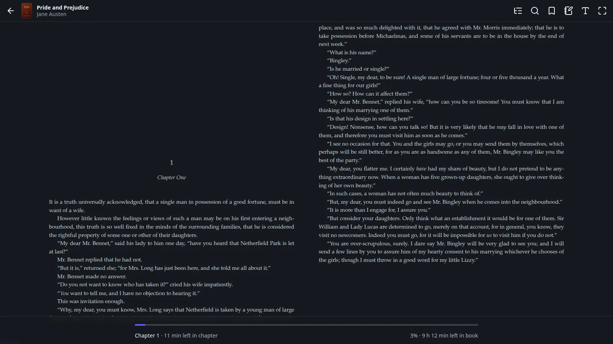

## Eine Bibliothek für Ihre Bücher

E-Books und Hörbücher gibt es jetzt in Fliks, neben Ihren Filmen und Serien.

### Ein Werk, alle Ausgaben
- Ein Buch ist ein Werk: Seine E-Book- und Hörbuch-Ausgaben liegen zusammen, jeweils mit Sprache, Format, Verlag und Seitenzahl oder Dauer.
- Stöbern Sie nach Büchern, Reihen und Autoren. Eine Reihe zeigt die fehlenden Bände und den nächsten zum Lesen, und die Seite eines Autors listet die gesamte Bibliografie auf.
- Filtern Sie nach Format, Sprache, Autor, Sprecher oder angefangenen Büchern.

### Metadaten aus offenen Quellen
- Open Library, die BnF und Google Books für E-Books, Audible und Audnexus für Hörbücher. Sie bestimmen die Reihenfolge.
- Eine Reihe kann auch von Hand festgelegt werden.

### Bücher beschaffen
- Nutzer fordern eine Ausgabe in der gewünschten Sprache an, im Rahmen ihrer Kontingente.
- Importieren Sie eine bestehende Bibliothek auf einmal, oder kopieren und verschieben Sie Dateien über die Seite für den manuellen Import.
- Senden Sie ein Buch per E-Mail an einen Kindle, einen PocketBook oder eine beliebige Adresse.

## In Fliks lesen

Ein einziger Leser für EPUB, EPUB mit festem Layout, PDF und CBZ.

### Ganz nach Ihrem Geschmack
- Sechs Designs, von Original und Sepia bis Nacht und Reines Schwarz.
- Vier Schriftarten, darunter Literata und Atkinson Hyperlegible.
- Textgröße, Zeilenabstand, Ränder, Spalten und Blocksatz.
- Seiten umblättern oder scrollen.

### Notizen und Suche
- Markieren Sie in vier Farben, fügen Sie Notizen und Lesezeichen hinzu und exportieren Sie Ihre Notizen als Markdown.
- Durchsuchen Sie das Buch, springen Sie über das Inhaltsverzeichnis und sehen Sie die verbleibenden Minuten im Kapitel und im Buch.

### Überall
- Ihre Position wird wie bei jeder Wiedergabe gespeichert: Machen Sie auf einem anderen Gerät dort weiter, wo Sie aufgehört haben.
- Behalten Sie Bücher offline, um ohne Verbindung zu lesen.
- Wenn das Buch auch eine Hörbuch-Ausgabe hat, wechselt eine Schaltfläche Anhören dorthin.

## Hörbücher

### Ein Player für Bücher
- Geschwindigkeit von 0,5x bis 3x und Sprünge von 10 bis 60 Sekunden.
- Kapitel, Lesezeichen und ein Schlaf-Timer, der am Ende des Kapitels stoppen kann.
- Ein Mini-Player beim Stöbern und eine Vollbildansicht.
- Hörbücher werden unter Weiterhören fortgesetzt und erscheinen nicht unter Wiedergabe fortsetzen.

### Aufgeräumte Dateien
- Eine Option pro Bibliothek führt ein in viele Dateien aufgeteiltes Hörbuch zu einer einzigen m4b-Datei mit Kapiteln zusammen. Sie ist standardmäßig deaktiviert.
- Eine zweite Option löscht die Teile, sobald die m4b-Datei geprüft wurde.

### Offline
- Speichern Sie Hörbücher für unterwegs auf Ihrem Gerät.

## Comics

### Bände und Ausgaben
- Ein Band enthält seine Ausgaben, Jahresbände und Sonderhefte. Ein Variant-Cover wird zu einer weiteren Version derselben Ausgabe.
- Fliks liest die ComicInfo.xml aus CBZ-, CB7-, CBR- und PDF-Dateien. Ihre eigenen Änderungen bleiben bei erneuten Scans erhalten.
- Metron und Comic Vine ergänzen die Details, mit Ihrem eigenen API-Schlüssel.

### Fehlende Ausgaben
- Fliks kann nach den Ausgaben suchen, die einem Band fehlen, eine Ausgabe nach der anderen.

### Lesen
- Die Modi Seiten, Manga (von rechts nach links), Webtoon und Doppelseite, mit Zoom.

## E-Reader und Lese-Apps

Erstellen Sie in Ihrem Konto ein Token pro Gerät. Es wird nur einmal angezeigt und kann erneuert oder widerrufen werden.

### Kobo (experimentell)
- Ihre Bücher, Cover, Lesefortschritte und Regale werden mit einem Kobo-E-Reader synchronisiert.
- EPUBs werden beim ersten Download in KEPUB umgewandelt.

### KOReader
- Der Lesefortschritt wird über die Fortschrittssynchronisierung von KOReader mit Ihrem Fliks-Server abgeglichen.

### OPDS-Katalog
- Durchsuchen und laden Sie Ihre Bücher aus OPDS-Apps wie KOReader, Moon+ Reader oder Librera herunter. Comics werden Seite für Seite gestreamt.
