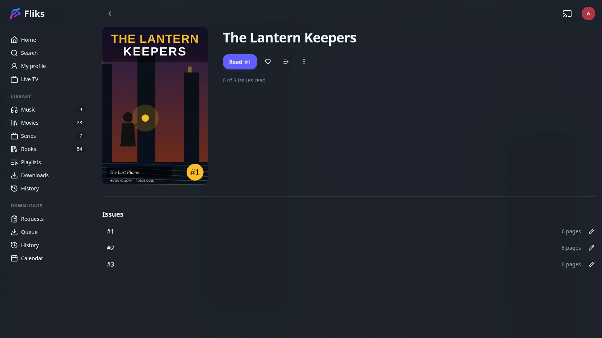

## A library for your books

Ebooks and audiobooks now live in Fliks, next to your films and series.

### One work, every edition
- A book is one work: its ebook and audiobook editions sit together, each with its language, format, publisher and page count or duration.
- Browse by books, series and authors. A series shows its missing volumes and the next one to read, and an author page lists the whole bibliography.
- Filter by format, language, author, narrator or books in progress.

### Metadata from open sources
- Open Library, the BnF and Google Books for ebooks, Audible and Audnexus for audiobooks. Each source is a plugin installed with Fliks: choose their order, or turn one off.
- A series can also be set by hand.

### Getting books
- Users request an edition in the language they want, within their quotas.
- Import an existing library in bulk, or copy and move files from the manual import page.
- Downloads go through the Download plugin, from the plugin catalogue.
- Add free ebooks from Project Gutenberg and free audiobooks from LibriVox with their plugins, from the catalogue.
- Send a book by e-mail to a Kindle, a PocketBook or any address.

## Read in Fliks

One reader for EPUB, fixed-layout EPUB, PDF and CBZ.

### Make it yours
- Six themes, from Original and Sepia to Night and Pure black.
- Four fonts, including Literata and Atkinson Hyperlegible.
- Text size, line spacing, margins, columns and justification.
- Turn pages or scroll.

### Notes and search
- Highlight in four colours, add notes and bookmarks, and export your notes as Markdown.
- Search the book, jump through the table of contents, and see the minutes left in the chapter and in the book.

### Everywhere
- Your position is saved like any playback: pick up where you stopped on another device.
- Keep books offline to read without a connection.
- When the book also has an audiobook edition, a Listen button switches to it.

## Audiobooks

### A player made for books
- Speed from 0.5x to 3x, and skip steps from 10 to 60 seconds.
- Chapters, bookmarks, and a sleep timer that can stop at the end of the chapter.
- A mini player while you browse, and a full-screen view.
- Audiobooks resume from Continue listening and stay out of Continue watching.

### Tidy files
- An option per library merges an audiobook split into many files into one m4b with chapters. It is off by default.
- A second option deletes the parts once the m4b has been verified.

### Offline
- Save audiobooks on your device for the road.

## Comics

### Volumes and issues
- A volume holds its issues, annuals and specials. A variant cover becomes another version of the same issue.
- Fliks reads ComicInfo.xml from CBZ, CB7, CBR and PDF files. Your own edits are kept across rescans.
- Metron and Comic Vine fill in the details. Both are plugins to install from the catalogue, with your own API key.

### Missing issues
- Fliks can look for the issues missing from a volume, one issue at a time.

### Reading
- Pages, Manga (right to left), Webtoon and Double page modes, with zoom.

## E-readers and reading apps

Create a token per device in your account. It is shown once and can be renewed or revoked.

### Kobo (experimental)
- Your books, covers, reading progress and shelves sync with a Kobo e-reader.
- EPUBs are converted to KEPUB on the first download.

### KOReader
- Reading progress syncs with KOReader through its Progress sync, using your Fliks server.

### OPDS catalogue
- Browse and download your books from OPDS apps such as KOReader, Moon+ Reader or Librera. Comics stream page by page.
