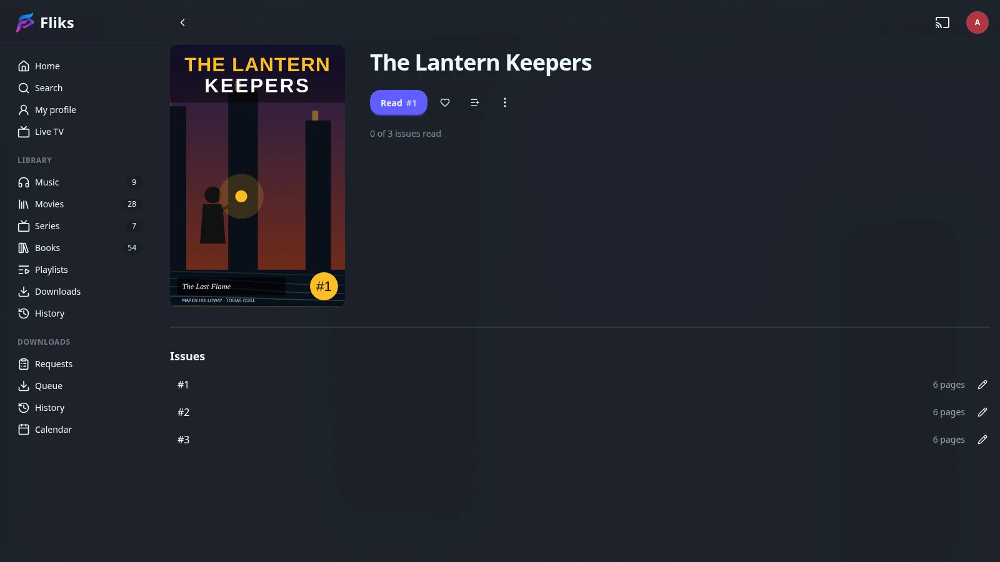

## Una biblioteca para sus libros

Los libros electrónicos y los audiolibros llegan a Fliks, junto a sus películas y series.

### Una obra, todas sus ediciones
- Un libro es una obra: sus ediciones en libro electrónico y en audiolibro están reunidas, cada una con su idioma, formato, editorial y número de páginas o duración.
- Explore por libros, series y autores. Una serie muestra los tomos que faltan y el siguiente por leer, y la página de un autor lista toda su bibliografía.
- Filtre por formato, idioma, autor, narrador o libros en curso.

### Metadatos de fuentes abiertas
- Open Library, la BnF y Google Books para libros electrónicos, Audible y Audnexus para audiolibros. Cada fuente es un plugin instalado con Fliks: elija su orden o desactive una.
- Una serie también se puede definir a mano.

### Conseguir libros
- Los usuarios solicitan una edición en el idioma que quieran, dentro de sus cuotas.
- Importe una biblioteca existente de una sola vez, o copie y mueva archivos desde la página de importación manual.
- Las descargas pasan por el plugin Download, del catálogo de plugins.
- Añada libros electrónicos gratuitos de Project Gutenberg y audiolibros gratuitos de LibriVox con sus plugins, del catálogo.
- Envíe un libro por correo electrónico a un Kindle, un PocketBook o cualquier dirección.

## Leer en Fliks

Un único lector para EPUB, EPUB de diseño fijo, PDF y CBZ.

### A su gusto
- Seis temas, desde Original y Sepia hasta Noche y Negro puro.
- Cuatro tipos de letra, entre ellos Literata y Atkinson Hyperlegible.
- Tamaño del texto, interlineado, márgenes, columnas y justificación.
- Pase las páginas o desplácese.

### Notas y búsqueda
- Resalte en cuatro colores, añada notas y marcadores, y exporte sus notas en Markdown.
- Busque en el libro, navegue por el índice y vea los minutos que quedan en el capítulo y en el libro.

### En todas partes
- Su posición se guarda como cualquier reproducción: retome donde lo dejó en otro dispositivo.
- Conserve libros sin conexión para leer sin red.
- Cuando el libro tiene también una edición en audiolibro, un botón Escuchar permite cambiar a ella.

## Audiolibros

### Un reproductor pensado para los libros
- Velocidad de 0,5x a 3x y saltos de 10 a 60 segundos.
- Capítulos, marcadores y un temporizador de sueño que puede detenerse al final del capítulo.
- Un minirreproductor mientras navega y una vista a pantalla completa.
- Los audiolibros se retoman desde Seguir escuchando y no aparecen en Reanudar la reproducción.

### Archivos ordenados
- Una opción por biblioteca fusiona un audiolibro dividido en varios archivos en un único m4b con capítulos. Está desactivada por defecto.
- Una segunda opción elimina las partes una vez verificado el m4b.

### Sin conexión
- Guarde audiolibros en su dispositivo para el camino.

## Cómics

### Volúmenes y números
- Un volumen agrupa sus números, anuales y especiales. Una portada alternativa se convierte en otra versión del mismo número.
- Fliks lee el ComicInfo.xml de los archivos CBZ, CB7, CBR y PDF. Sus propias modificaciones se conservan al volver a escanear.
- Metron y Comic Vine completan los datos. Ambos son plugins que se instalan desde el catálogo, con su propia clave de API.

### Números que faltan
- Fliks puede buscar los números que faltan en un volumen, de uno en uno.

### Lectura
- Modos Páginas, Manga (de derecha a izquierda), Webtoon y Doble página, con zoom.

## Lectores electrónicos y aplicaciones de lectura

Cree un token por dispositivo en su cuenta. Se muestra una sola vez y se puede renovar o revocar.

### Kobo (experimental)
- Sus libros, portadas, progreso de lectura y estanterías se sincronizan con un lector Kobo.
- Los EPUB se convierten a KEPUB en la primera descarga.

### KOReader
- El progreso de lectura se sincroniza con KOReader mediante su sincronización de progreso, usando su servidor Fliks.

### Catálogo OPDS
- Explore y descargue sus libros desde aplicaciones OPDS como KOReader, Moon+ Reader o Librera. Los cómics se transmiten página a página.
