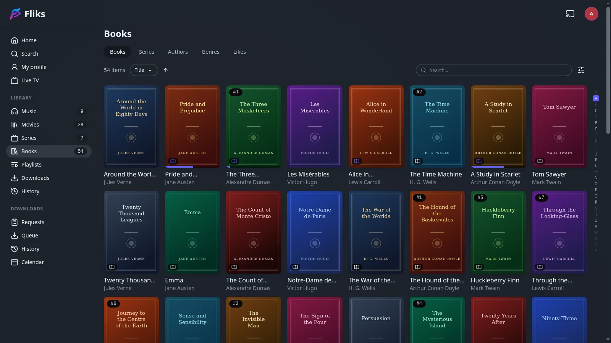

## Una libreria per i tuoi libri

Ebook e audiolibri arrivano in Fliks, accanto ai tuoi film e alle tue serie.

### Un'opera, tutte le sue edizioni
- Un libro è un'opera: le sue edizioni ebook e audiolibro sono riunite, ciascuna con la sua lingua, il formato, l'editore e il numero di pagine o la durata.
- Sfoglia per libri, serie e autori. Una serie mostra i volumi mancanti e il prossimo da leggere, e la pagina di un autore elenca tutta la bibliografia.
- Filtra per formato, lingua, autore, narratore o libri in corso.

### Metadati da fonti aperte
- Open Library, la BnF e Google Books per gli ebook, Audible e Audnexus per gli audiolibri. Scegli tu l'ordine.
- Una serie può anche essere definita a mano.

### Ottenere libri
- Gli utenti richiedono un'edizione nella lingua che vogliono, entro i limiti delle loro quote.
- Importa una libreria esistente in un colpo solo, oppure copia e sposta i file dalla pagina di importazione manuale.
- Invia un libro per e-mail a un Kindle, a un PocketBook o a qualsiasi indirizzo.

## Leggere in Fliks

Un solo lettore per EPUB, EPUB a layout fisso, PDF e CBZ.

### A modo tuo
- Sei temi, da Originale e Seppia fino a Notte e Nero puro.
- Quattro caratteri, tra cui Literata e Atkinson Hyperlegible.
- Dimensione del testo, interlinea, margini, colonne e giustificazione.
- Sfoglia le pagine o scorri.

### Note e ricerca
- Evidenzia in quattro colori, aggiungi note e segnalibri, ed esporta le tue note in Markdown.
- Cerca nel libro, naviga con l'indice e guarda i minuti rimasti nel capitolo e nel libro.

### Ovunque
- La tua posizione viene salvata come qualsiasi riproduzione: riprendi da dove ti eri fermato su un altro dispositivo.
- Tieni i libri offline per leggere senza connessione.
- Quando il libro ha anche un'edizione audiolibro, un pulsante Ascolta permette di passare a quella.

## Audiolibri

### Un lettore pensato per i libri
- Velocità da 0,5x a 3x e salti da 10 a 60 secondi.
- Capitoli, segnalibri e un timer di spegnimento che può fermarsi alla fine del capitolo.
- Un mini player mentre navighi e una vista a schermo intero.
- Gli audiolibri riprendono da Continua ad ascoltare e non compaiono in Riprendi la riproduzione.

### File in ordine
- Un'opzione per libreria unisce un audiolibro suddiviso in più file in un unico m4b con capitoli. È disattivata per impostazione predefinita.
- Una seconda opzione elimina le parti una volta verificato l'm4b.

### Offline
- Salva gli audiolibri sul tuo dispositivo per il viaggio.

## Fumetti

### Volumi e numeri
- Un volume raccoglie i suoi numeri, annuali e speciali. Una copertina variant diventa un'altra versione dello stesso numero.
- Fliks legge il ComicInfo.xml dei file CBZ, CB7, CBR e PDF. Le tue modifiche restano dopo le nuove scansioni.
- Metron e Comic Vine completano i dettagli, con la tua chiave API.

### Numeri mancanti
- Fliks può cercare i numeri che mancano a un volume, uno alla volta.

### Lettura
- Modalità Pagine, Manga (da destra a sinistra), Webtoon e Doppia pagina, con zoom.

## E-reader e app di lettura

Crea un token per dispositivo nel tuo account. Viene mostrato una sola volta e può essere rinnovato o revocato.

### Kobo (sperimentale)
- I tuoi libri, le copertine, i progressi di lettura e gli scaffali si sincronizzano con un lettore Kobo.
- Gli EPUB vengono convertiti in KEPUB al primo download.

### KOReader
- I progressi di lettura si sincronizzano con KOReader tramite la sua sincronizzazione dei progressi, usando il tuo server Fliks.

### Catalogo OPDS
- Sfoglia e scarica i tuoi libri da app OPDS come KOReader, Moon+ Reader o Librera. I fumetti arrivano pagina per pagina.
