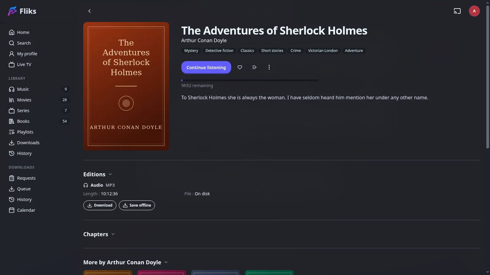
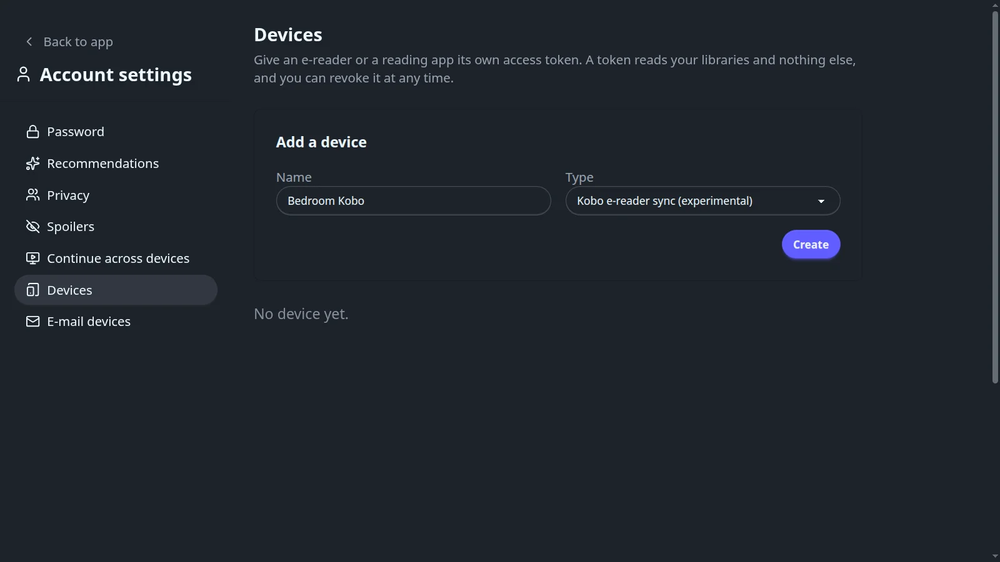

## Uma biblioteca para os seus livros

Os livros digitais e os audiolivros chegam ao Fliks, ao lado dos seus filmes e séries.

### Uma obra, todas as edições
- Um livro é uma obra: as suas edições digital e em áudio ficam reunidas, cada uma com o seu idioma, formato, editora e número de páginas ou duração.
- Navegue por livros, séries e autores. Uma série mostra os volumes em falta e o próximo a ler, e a página de um autor lista toda a bibliografia.
- Filtre por formato, idioma, autor, narrador ou livros em curso.

### Metadados de fontes abertas
- Open Library, a BnF e o Google Books para livros digitais, Audible e Audnexus para audiolivros. Cada fonte é um plugin instalado com o Fliks: escolha a ordem ou desative uma.
- Uma série também pode ser definida à mão.

### Obter livros
- Os utilizadores pedem uma edição no idioma que quiserem, dentro das suas quotas.
- Importe uma biblioteca existente de uma só vez, ou copie e mova ficheiros a partir da página de importação manual.
- As transferências passam pelo plugin Download, do catálogo de plugins.
- Adicione livros digitais gratuitos do Project Gutenberg e audiolivros gratuitos do LibriVox com os respetivos plugins, do catálogo.
- Envie um livro por e-mail para um Kindle, um PocketBook ou qualquer endereço.

## Ler no Fliks

Um único leitor para EPUB, EPUB de disposição fixa, PDF e CBZ.

### À sua maneira
- Seis temas, desde Original e Sépia até Noite e Preto puro.
- Quatro tipos de letra, incluindo Literata e Atkinson Hyperlegible.
- Tamanho do texto, espaçamento entre linhas, margens, colunas e justificação.
- Vire as páginas ou desloque.

### Notas e pesquisa
- Realce em quatro cores, adicione notas e marcadores, e exporte as suas notas em Markdown.
- Pesquise no livro, navegue pelo índice e veja os minutos restantes no capítulo e no livro.

### Em todo o lado
- A sua posição é guardada como qualquer reprodução: retome onde parou noutro dispositivo.
- Mantenha livros offline para ler sem ligação.
- Quando o livro tem também uma edição em áudio, um botão Ouvir permite passar para ela.

## Audiolivros

### Um leitor pensado para os livros
- Velocidade de 0,5x a 3x e saltos de 10 a 60 segundos.
- Capítulos, marcadores e um temporizador de sono que pode parar no fim do capítulo.
- Um mini leitor enquanto navega e uma vista em ecrã inteiro.
- Os audiolivros retomam a partir de Continuar a ouvir e não aparecem em Retomar a reprodução.

### Ficheiros arrumados
- Uma opção por biblioteca junta um audiolivro dividido em vários ficheiros num único m4b com capítulos. Está desativada por predefinição.
- Uma segunda opção elimina as partes depois de o m4b ser verificado.

### Offline
- Guarde audiolivros no dispositivo para a estrada.

## Banda desenhada

### Volumes e números
- Um volume agrupa os seus números, anuais e especiais. Uma capa variante torna-se outra versão do mesmo número.
- O Fliks lê o ComicInfo.xml dos ficheiros CBZ, CB7, CBR e PDF. As suas próprias alterações mantêm-se nas novas análises.
- Metron e Comic Vine completam os detalhes. São dois plugins a instalar a partir do catálogo, com a sua própria chave de API.

### Números em falta
- O Fliks pode procurar os números que faltam num volume, um número de cada vez.

### Leitura
- Modos Páginas, Mangá (da direita para a esquerda), Webtoon e Página dupla, com zoom.

## Leitores eletrónicos e aplicações de leitura

Crie um token por dispositivo na sua conta. É mostrado uma só vez e pode ser renovado ou revogado.

### Kobo (experimental)
- Os seus livros, capas, progresso de leitura e prateleiras sincronizam com um leitor Kobo.
- Os EPUB são convertidos em KEPUB no primeiro descarregamento.

### KOReader
- O progresso de leitura sincroniza com o KOReader através da sua sincronização de progresso, usando o seu servidor Fliks.

### Catálogo OPDS
- Navegue e descarregue os seus livros a partir de aplicações OPDS como KOReader, Moon+ Reader ou Librera. A banda desenhada é transmitida página a página.
