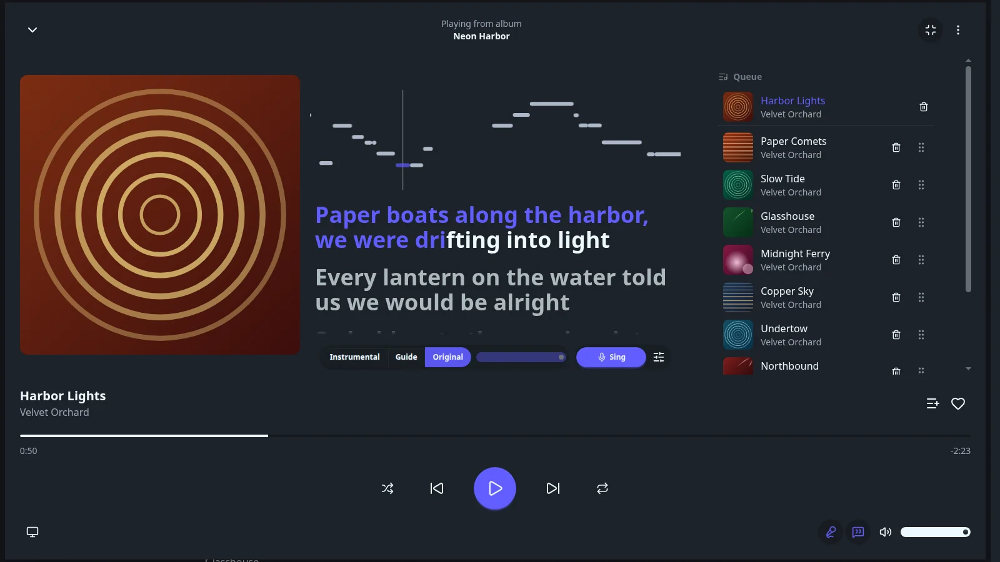
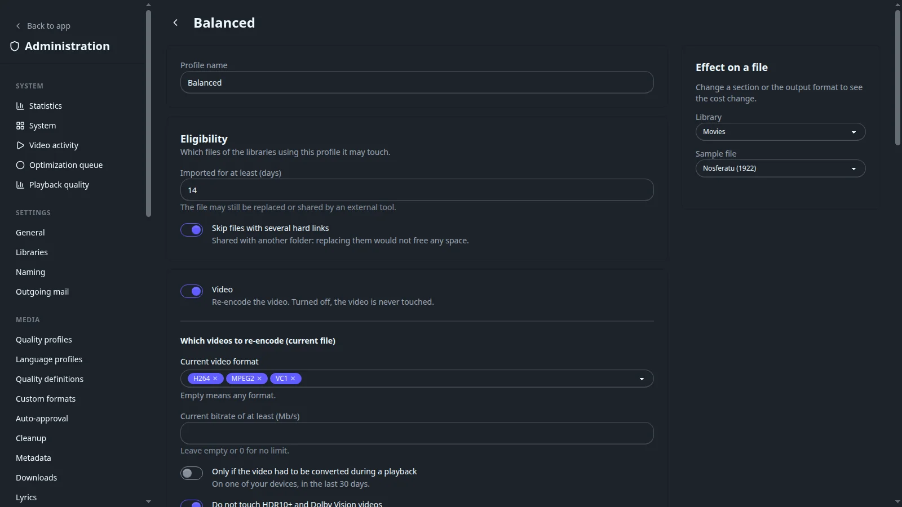

## Votre bibliothèque musicale

La musique rejoint les films, séries et livres, de l'acquisition à l'écoute.

### Les albums tels qu'ils sont sortis
- Un album correspond à une sortie MusicBrainz, avec sa pochette issue de la Cover Art Archive et les images d'artistes de Fanart.tv. Tous deux passent par des plugins installés avec Fliks. Les autres versions du même album se replient dans une rangée sur sa page.
- Suivez un artiste pour recevoir les nouveaux albums de sa discographie, filtrés selon les types acceptés par votre bibliothèque (albums, EP, singles, live...).
- Suivez des listes ListenBrainz, Last.fm, Spotify, Deezer ou MusicBrainz avec le plugin Music lists, depuis le catalogue.

### Importer ce que vous avez déjà
- Fliks lit vos tags : le dossier est l'album, les dossiers de disques sont fusionnés, et les identifiants MusicBrainz décident de l'association.
- L'écriture des tags dans vos fichiers est à activer. Une bibliothèque Lidarr peut être importée.

### Paroles
- Depuis vos fichiers (intégrées, ou .lrc, .elrc, .ttml, .srt, .txt à côté du morceau), depuis LRCLIB (un plugin installé avec Fliks), ou écrites par vous avec un éditeur de synchronisation au toucher.
- Paroles mot par mot quand la source les fournit. Réordonnez ou désactivez les sources de paroles.

## Chercher, écouter, emporter

### Une seule recherche
- Un meilleur résultat, puis les titres, albums et artistes, avec les tendances du jour et de la semaine.
- Ajoutez un seul titre ou un album entier, ou envoyez une demande : les utilisateurs demandent, les admins approuvent.
- L'aperçu d'ajout montre la liste des titres avant tout téléchargement.

### Lecteurs
- Un mini-lecteur qui s'ouvre en lecteur complet, avec la file d'attente, les paroles et l'égalisation du volume par titre ou par album (ReplayGain).
- Playlists intelligentes et import m3u.
- Gardez titres, albums, playlists ou artistes hors ligne.

### Vos applications préférées
- Fliks parle OpenSubsonic : connectez une application musicale compatible avec un jeton de votre compte.

## Karaoké

Chantez sur n'importe quel titre de votre bibliothèque. Un admin active le karaoké et installe un modèle de séparation des voix depuis la page Karaoké.

### Préparé par Fliks
- La voix est séparée de la musique, à la demande quand vous ouvrez un titre, ou en arrière-plan sur vos bibliothèques musicales.
- Sans paroles synchronisées au mot, Fliks aligne le texte existant mot par mot. Les chœurs devinés apparaissent atténués.
- Une mélodie de référence est tracée pour suivre les notes.
- Le travail peut tourner sur un GPU, sur le processeur ou sur vos workers d'optimisation.

### Sur scène
- Un score par chanteur, de Facile à Difficile, avec des notes dorées qui comptent double et un tableau des scores.
- Pour les duos et les voix qui se chevauchent, chaque ligne indique quel chanteur la chante.
- Changez la tonalité pour l'adapter à votre voix.

## Soirées karaoké

### Tout le monde chante
- Pendant une soirée, les téléphones deviennent des micros : seule la hauteur de la voix est envoyée, jamais votre voix.
- Le programme de la soirée est la file des chanteurs, avec un interrupteur pour chanter chacun son tour.

### Sur tous les écrans
- Paroles et pistes séparées sont jouées sur un Chromecast.

### Apportez vos chansons
- Importez des chansons UltraStar, pistes séparées comprises, et des disques MP3+G avec leurs graphismes CD+G.

## Optimisation des bibliothèques

Réencodez ou remuxez vos fichiers vidéo pour gagner de la place ou pour les lire directement sur vos appareils.

### Un profil par bibliothèque
- Partez de Équilibré, Nettoyage seul ou Lecture directe, puis réglez vidéo, audio, sous-titres et garde-fous.
- La vidéo n'est réencodée en HEVC ou AV1 que si c'est vraiment plus efficace que la source. Les bandes noires peuvent être rognées, et les fichiers HDR10+ et Dolby Vision laissés tels quels.
- Les pistes audio et sous-titres sont triées et allégées par langue. Les commentaires partent, les langues inconnues restent toujours.
- Prévisualisez l'effet par fichier et par bibliothèque avant de lancer. Les nouveaux fichiers peuvent entrer dans la file automatiquement une fois assez anciens.

### Un remplacement sûr
- Chaque fichier produit est vérifié avant de remplacer l'original, qui part dans une corbeille d'où il peut être restauré jusqu'à sa purge.
- Un fichier en cours de lecture n'est jamais remplacé : la tâche attend.
- Des vérifications planifiées peuvent relire toute la bibliothèque pour trouver les fichiers abîmés.

### Plus de machines
- Ajoutez des workers distants avec un jeton, et utilisez plusieurs GPU par machine en gardant une réserve pour la lecture.
- Suivez la file, les échecs et les tâches terminées sur la page Optimisation, avec plage horaire, pause et priorité.
