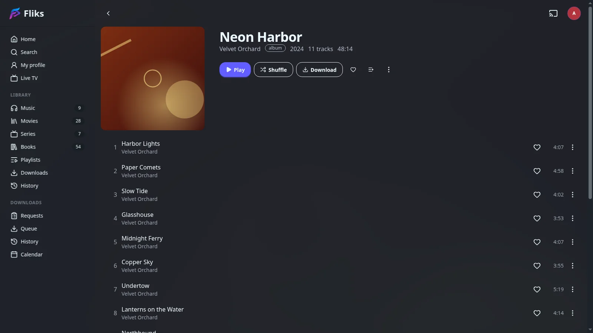

## La tua libreria musicale

La musica si unisce a film, serie e libri, dall'acquisizione alla riproduzione.

### Album come sono stati pubblicati
- Un album è una release di MusicBrainz, con la sua copertina dal Cover Art Archive e le immagini degli artisti da Fanart.tv. Entrambe arrivano tramite plugin installati con Fliks. Le altre versioni dello stesso album si raccolgono in una riga nella sua pagina.
- Segui un artista per ricevere i nuovi album della sua discografia, filtrati per i tipi che la tua libreria accetta (album, EP, singoli, live...).
- Segui le liste di ListenBrainz, Last.fm, Spotify, Deezer o MusicBrainz con il plugin Music lists, dal catalogo.

### Importa ciò che hai già
- Fliks legge i tuoi tag: la cartella è l'album, le cartelle dei dischi vengono unite e gli id MusicBrainz decidono la corrispondenza.
- La scrittura dei tag nei tuoi file è facoltativa. Si può importare una libreria Lidarr.

### Testi
- Dai tuoi file (incorporati o .lrc, .elrc, .ttml, .srt, .txt accanto al brano), da LRCLIB (un plugin installato con Fliks), o scritti da te con un editor in cui sincronizzi con un tocco.
- Testi parola per parola quando la fonte li ha. Riordina o disattiva le fonti dei testi.

## Cerca, ascolta, portala con te

### Una sola ricerca
- Un risultato principale, poi brani, album e artisti, con ciò che è in tendenza oggi e questa settimana.
- Aggiungi un singolo brano o un intero album, oppure invia una richiesta: gli utenti chiedono, gli admin approvano.
- L'anteprima di aggiunta mostra la tracklist prima di scaricare qualsiasi cosa.

### Lettori
- Un mini player che si apre nel lettore completo, con la coda, i testi e il livellamento del volume per brano o album (ReplayGain).
- Playlist intelligenti e importazione m3u.
- Tieni brani, album, playlist o artisti offline.

### Le tue app preferite
- Fliks parla OpenSubsonic: collega un'app musicale compatibile con un token del tuo account.

## Karaoke
Canta qualsiasi brano della tua libreria. Un admin attiva il karaoke e installa un modello di separazione della voce dalla pagina Karaoke.

### Preparato da Fliks
- La voce viene separata dalla musica, su richiesta quando apri un brano, oppure in background sulle tue librerie musicali.
- Senza testi con i tempi parola per parola, Fliks allinea il testo esistente parola per parola. Le parole dei cori ipotizzate appaiono attenuate.
- Viene disegnata una melodia di riferimento per seguire le note.
- Il lavoro può girare su una GPU, sul processore o sui tuoi worker di ottimizzazione.

### Sul palco
- Un punteggio per cantante, da Facile a Difficile, con note dorate che valgono il doppio e una classifica.
- Duetti e voci sovrapposte mostrano quale cantante canta quale riga.
- Cambia la tonalità per adattarla alla tua voce.

## Feste karaoke

### Cantano tutti
- In una festa, i telefoni diventano microfoni: viene inviata solo l'intonazione, mai la tua voce.
- Il programma della festa è la coda dei cantanti, con un interruttore per far cantare a turno.

### Su ogni schermo
- Testi e tracce separate si riproducono su un Chromecast.

### Porta le tue canzoni
- Importa canzoni UltraStar, tracce separate incluse, e dischi MP3+G con la loro grafica CD+G.

## Ottimizzazione della libreria

Ricodifica o remuxa i tuoi file video per risparmiare spazio o per riprodurli direttamente sui tuoi dispositivi.

### Un profilo per libreria
- Parti da Bilanciato, Solo pulizia o Riproduzione diretta, poi regola video, audio, sottotitoli e salvaguardie.
- Il video viene ricodificato in HEVC o AV1 solo quando è davvero più efficiente della sorgente. Le bande nere possono essere ritagliate, i file HDR10+ e Dolby Vision possono essere lasciati intatti.
- Le tracce audio e dei sottotitoli vengono ordinate e ridotte per lingua. Le tracce di commento vengono tolte, le lingue sconosciute restano sempre.
- Visualizza in anteprima l'effetto per file e per libreria prima di iniziare. I nuovi file possono essere messi in coda automaticamente quando sono abbastanza vecchi.

### Sostituzione sicura
- Ogni output viene verificato prima di sostituire l'originale, che va in un cestino da cui puoi ripristinarlo finché non viene svuotato.
- Un file in riproduzione non viene mai sostituito: il job aspetta.
- Controlli programmati possono leggere l'intera libreria per trovare file danneggiati.

### Più macchine
- Aggiungi worker remoti con un token e usa più GPU per macchina, con una riserva tenuta per la riproduzione.
- Segui la coda, gli errori e i job completati nella pagina Ottimizzazione, con finestra oraria, pausa e priorità.
