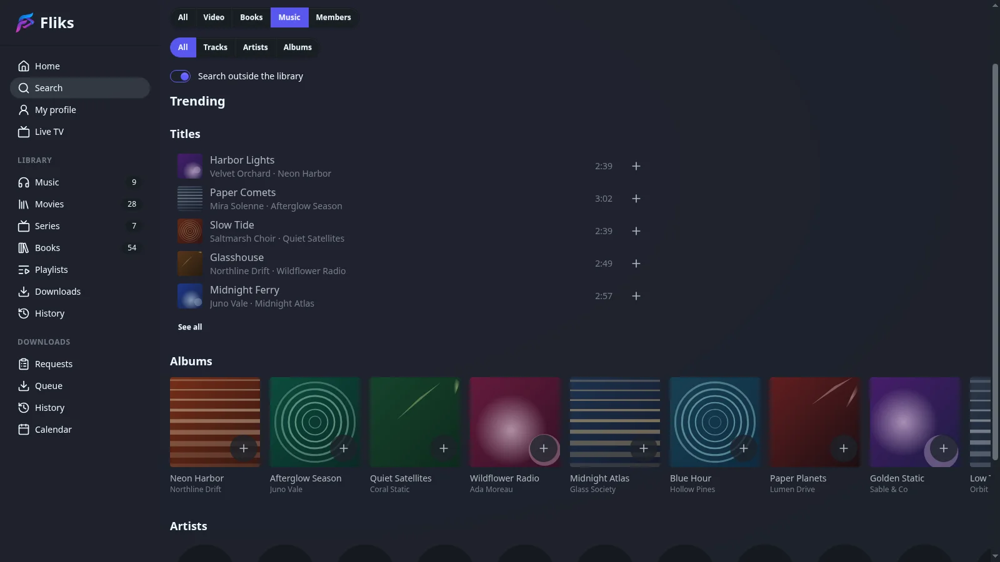

## A sua biblioteca de música

A música junta-se aos filmes, séries e livros, da aquisição à reprodução.

### Álbuns tal como foram lançados
- Um álbum é um lançamento do MusicBrainz, com a sua capa do Cover Art Archive e imagens de artistas do Fanart.tv. Ambas chegam através de plugins instalados com o Fliks. As outras versões do mesmo álbum agrupam-se numa linha na sua página.
- Siga um artista para receber os novos álbuns da sua discografia, filtrados pelos tipos que a sua biblioteca aceita (álbuns, EP, singles, ao vivo...).
- Siga listas do ListenBrainz, Last.fm, Spotify, Deezer ou MusicBrainz com o plugin Music lists, do catálogo.

### Importe o que já tem
- O Fliks lê as suas etiquetas: a pasta é o álbum, as pastas de disco são juntadas e os ids do MusicBrainz decidem a correspondência.
- Gravar as etiquetas de volta nos seus ficheiros é opcional. Pode importar-se uma biblioteca Lidarr.

### Letras
- A partir dos seus ficheiros (incorporadas ou .lrc, .elrc, .ttml, .srt, .txt junto à faixa), do LRCLIB (um plugin instalado com o Fliks), ou escritas por si com um editor onde sincroniza com um toque.
- Letras palavra a palavra quando a fonte as tem. Reordene ou desative as fontes de letras.

## Pesquisar, ouvir, levar consigo

### Uma só pesquisa
- Um resultado principal, depois faixas, álbuns e artistas, com o que está em tendência hoje e esta semana.
- Adicione uma única faixa ou um álbum inteiro, ou envie um pedido: os utilizadores pedem, os administradores aprovam.
- A pré-visualização ao adicionar mostra a lista de faixas antes de se descarregar o que quer que seja.

### Leitores
- Um mini leitor que se abre no leitor completo, com a fila, as letras e o nivelamento de volume por faixa ou álbum (ReplayGain).
- Listas de reprodução inteligentes e importação de m3u.
- Mantenha faixas, álbuns, listas de reprodução ou artistas offline.

### As suas aplicações favoritas
- O Fliks fala OpenSubsonic: ligue uma aplicação de música compatível com um token da sua conta.

## Karaoke
Cante qualquer faixa da sua biblioteca. Um administrador ativa o karaoke e instala um modelo de separação de voz a partir da página Karaoke.

### Preparado pelo Fliks
- A voz é separada da música, a pedido ao abrir uma faixa, ou em segundo plano nas suas bibliotecas de música.
- Sem letras com tempos por palavra, o Fliks alinha o texto existente palavra a palavra. As palavras de coros presumidas aparecem esbatidas.
- É desenhada uma melodia de referência para poder seguir as notas.
- O trabalho pode correr numa GPU, no processador ou nos seus workers de otimização.

### No palco
- Uma pontuação por cantor, de Fácil a Difícil, com notas douradas que valem o dobro e um placar.
- Os duetos e as vozes sobrepostas mostram que cantor canta que linha.
- Mude a tonalidade para a ajustar à sua voz.

## Festas de karaoke

### Todos cantam
- Numa festa, os telemóveis tornam-se microfones: só o tom é enviado, nunca a sua voz.
- O programa da festa é a fila de cantores, com um interruptor para os cantores se alternarem.

### Em todos os ecrãs
- As letras e as faixas separadas são reproduzidas num Chromecast.

### Traga as suas canções
- Importe canções UltraStar, faixas separadas incluídas, e discos MP3+G com os seus gráficos CD+G.

## Otimização da biblioteca

Recodifique ou remuxe os seus ficheiros de vídeo para poupar espaço ou para os reproduzir diretamente nos seus dispositivos.

### Um perfil por biblioteca
- Parta de Equilibrado, Só limpeza ou Reprodução direta, e depois ajuste o vídeo, o áudio, as legendas e as salvaguardas.
- O vídeo é recodificado para HEVC ou AV1 apenas quando é realmente mais eficiente do que a origem. As barras pretas podem ser cortadas e os ficheiros HDR10+ e Dolby Vision podem ser deixados intactos.
- As faixas de áudio e de legendas são ordenadas e reduzidas por idioma. As faixas de comentários saem, os idiomas desconhecidos ficam sempre.
- Pré-visualize o efeito por ficheiro e por biblioteca antes de começar. Os ficheiros novos podem ser colocados em fila automaticamente quando forem suficientemente antigos.

### Substituição segura
- Cada saída é verificada antes de substituir o original, que vai para um lixo de onde o pode restaurar até ser purgado.
- Um ficheiro que está a ser reproduzido nunca é trocado: a tarefa espera.
- Verificações agendadas podem ler toda a sua biblioteca para encontrar ficheiros danificados.

### Mais máquinas
- Adicione workers remotos com um token e use várias GPU por máquina, com uma reserva guardada para a reprodução.
- Acompanhe a fila, as falhas e as tarefas concluídas na página Otimização, com janela horária, pausa e prioridade.
